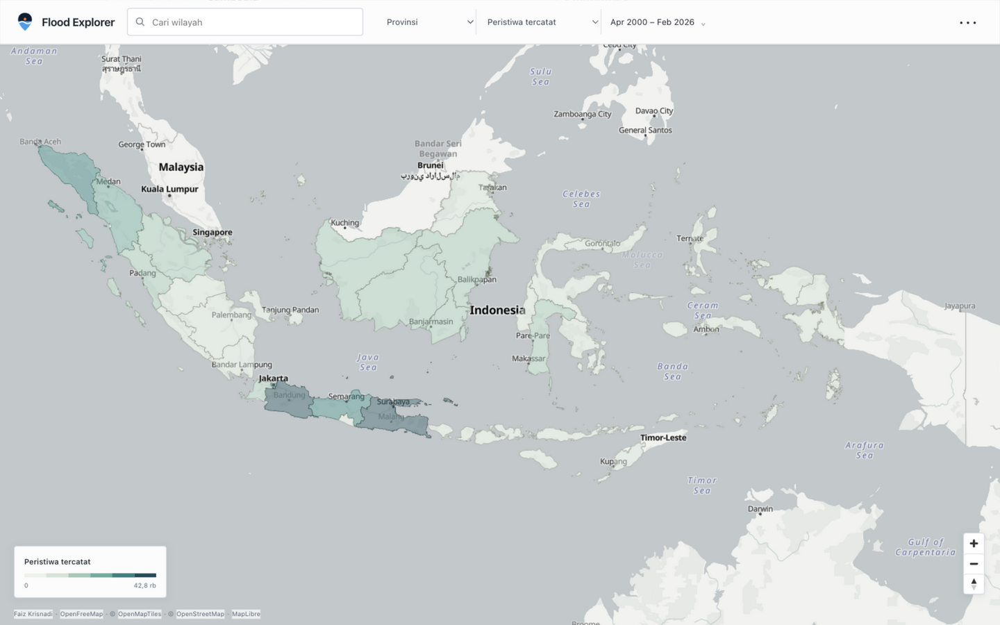
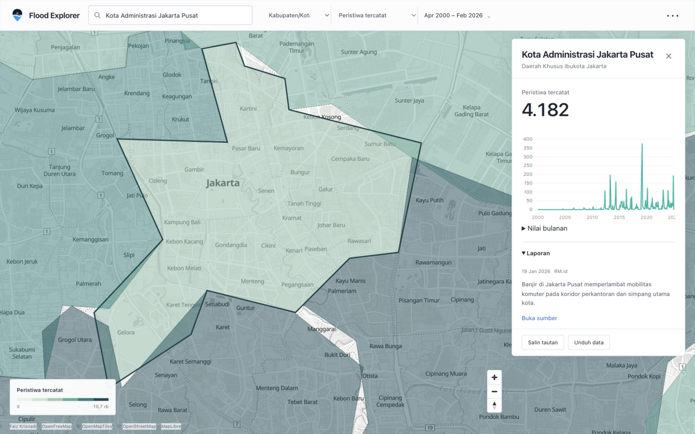

<p align="center">
  
</p>

<h1 align="center">Indonesia Flood Explorer</h1>

<p align="center">
  <strong>Twenty-six years of flood footprints, mapped against auditable Indonesian administrative geography.</strong>
</p>

<p align="center">
  Open civic-tech data infrastructure · static public explorer · bilingual UI · manifest-driven release assets
</p>

<p align="center">
  <a href="https://github.com/FaizKrisnadi/flood-explorer/actions/workflows/tests.yml">
    
  </a>
  <a href="LICENSE">
    
  </a>
  <a href="https://flood.faizkrisnadi.com">
    
  </a>
</p>

<p align="center">
  <a href="#overview"><code>Overview</code></a>
  <span>·</span>
  <a href="#what-the-map-shows"><code>What the Map Shows</code></a>
  <span>·</span>
  <a href="#why-geometry-not-names"><code>Why Geometry, Not Names</code></a>
  <span>·</span>
  <a href="#designed-to-fail-closed"><code>Fail-Closed by Design</code></a>
  <span>·</span>
  <a href="#repository-layout"><code>Layout</code></a>
  <span>·</span>
  <a href="#quick-start"><code>Quick Start</code></a>
  <span>·</span>
  <a href="#public-data-contract"><code>Data Contract</code></a>
</p>

---

## Overview

> Open the deployed explorer at [flood.faizkrisnadi.com](https://flood.faizkrisnadi.com).

This repository packages the ETL, release gating, and static delivery workflow for publishing Groundsource flood activity against Indonesia's administrative geography. Flood polygons are intersected with official boundaries, rolled up into monthly metrics, and shipped as committed JSON — the entire public product is one static directory that can be hosted anywhere.

The numbers behind the map:

- **Apr 2000 – Feb 2026** of monthly flood footprints — 250 month buckets per geography level.
- **38 provinces · 514 regencies/cities · 7,285 districts**, all at 100% boundary coverage for the published levels.
- **4 metrics** per geography: recorded events, flood days, cumulative overlap area, and maximum coverage ratio.
- **66 curated qualitative reports**, each rendered only when its source link passes eligibility screening.

## What the Map Shows

The explorer is a single map workspace: search for any province, regency, or district; switch level and metric from the toolbar; and drill into a region for its monthly trend and evidence reports.

<table>
  <tr>
    <td width="50%" valign="top">
      <strong>Every geography, one query</strong><br />
      The choropleth recolors as you move between province, regency/city, and district levels — no page reloads, no app server. The browser reads committed GeoJSON and JSON payloads straight from <code>site/data/latest/</code>.
    </td>
    <td width="50%" valign="top">
      <strong>Drill-down with evidence</strong><br />
      Selecting a region opens its record: headline metric, monthly trend chart, and the qualitative reports behind it — each with a date and a source link that has passed the release gate.
    </td>
  </tr>
</table>

<p align="center">
  
</p>

<p align="center">
  <em>Drill-down on Kota Administrasi Jakarta Pusat: 4,182 recorded events since 2000, with the January 2026 commuter-disruption report and its cited source.</em>
</p>

## Why Geometry, Not Names

- Groundsource does not provide Indonesia province, regency, district, village, or postal-code fields.
- Every Indonesia location result in this repo is produced by geometry overlap, not by text matching or name inference.
- The ETL decodes Groundsource flood polygons from WKB, intersects them with Indonesian administrative polygons, and aggregates the overlap results by province, regency/city, and district.
- A single flood event can intersect multiple districts, regencies, or provinces. The dashboard is therefore an overlap-based aggregate view, not a single authoritative district label for each event.
- Public metrics such as `unique_event_count`, `sum_intersection_area_km2`, and `max_coverage_ratio` describe intersecting events within each geography and period.

## Designed to Fail Closed

Public-interest data earns trust by showing its work, so the release pipeline prefers silence over shaky claims:

- **Auditable joins.** Administrative boundaries are keyed by stable Kemendagri-style codes; coverage reports are published alongside the data instead of hidden in a build log.
- **Withheld, not fudged.** Every qualitative report must carry a source link that passes URL eligibility screening (`scripts/audit_report_sources.py`). Records without a publishable source stay invisible — a report that can't be checked is treated as unpublished, never as verified.
- **Static and pinned.** The release is plain files with manifest-driven paths, browser-side re-screening of the same gate, CDN scripts pinned with subresource-integrity hashes, and CI that runs the validators on every push.

## Repository Layout

| Path | Purpose |
| --- | --- |
| `site/` | Static frontend, translations, and committed runtime payload |
| `site/data/latest/` | Browser-consumed public release assets committed with the repo |
| `scripts/` | ETL, packaging, validation, and build helpers |
| `tests/` | Python test coverage for pipeline and repo validation helpers |
| `docs/` | Data model notes, maintainer docs, and project positioning |

Local source downloads and intermediate build outputs under `data/raw/` and `data/processed/` are intentionally not tracked.

## Quick Start

Geometry-heavy scripts should be run on Python 3.13.

```bash
python3.13 -m venv .venv
./.venv/bin/pip install -r requirements.txt
```

Preview the explorer locally — no build step needed:

```bash
python3 -m http.server 4173 --directory site
```

Then open `http://127.0.0.1:4173/`.

### Rebuild Workflow

1. Inspect the remote Groundsource parquet without downloading it.

```bash
./.venv/bin/python scripts/inspect_groundsource.py
```

2. Fetch Indonesia reference sources into `data/raw/`.

```bash
./.venv/bin/python scripts/fetch_sources.py --province 31
```

3. Build canonical reference outputs into `data/processed/`.

```bash
./.venv/bin/python scripts/build_reference_geoparquet.py
```

4. Build Groundsource facts after `data/raw/groundsource/groundsource_2026.parquet` exists locally.

```bash
./.venv/bin/python scripts/build_groundsource_facts.py
```

If the Groundsource parquet is missing, the script writes a manifest with `missing_groundsource_source` instead of failing the entire build.

5. Package the public site payload into `site/data/latest/`.

```bash
./.venv/bin/python scripts/build_public_site_data.py
```

That packaging step refreshes `build_manifest.json`, the boundary GeoJSON layers, search index, coverage report, methodology, per-level metrics, and the qualitative payloads described below.

## Public Data Contract

The public artifact consumed by the browser is the committed `site/data/latest/` tree. The stable release contract is:

- `build_manifest.json`: runtime entrypoint for default language, levels, metrics, and asset paths.
- `boundaries/province.geojson`, `boundaries/regency.geojson`, `boundaries/district.geojson`: simplified browser-facing geometry layers.
- `metrics/<level>/summary_all_time.json`: rolled-up metrics per published level.
- `metrics/<level>/month/*.json`: month buckets listed in the build manifest.
- `metrics/<level>/trend/*.json`: geography-specific trend shards consumed on drill-down.
- `coverage_report.json`: release-gate and coverage metadata for the published geography.
- `search_index.json`: lookup index for province, regency/city, and district search.
- `methodology.json`: source, metric, and caveat metadata rendered by the frontend.
- `qualitative_events.json`: global qualitative evidence fallback payload.
- `geography_review_states.json`: global review-state fallback payload.
- `regencies/index.json`: registry for regency-specific qualitative bundles loaded on demand.

Groundsource remains the flood-event source of truth. Indonesian admin codes remain the canonical join keys. The public release currently publishes province, regency/city, and district layers only. The dashboard is for public information, not early warning or operational emergency response.

## Project Health

- Contributor guide: [CONTRIBUTING.md](CONTRIBUTING.md)
- Security policy: [SECURITY.md](SECURITY.md)
- Code of conduct: [CODE_OF_CONDUCT.md](CODE_OF_CONDUCT.md)
- Changelog: [CHANGELOG.md](CHANGELOG.md)
- Citation metadata: [CITATION.cff](CITATION.cff)
- Maintainer release notes: [docs/maintainer-release.md](docs/maintainer-release.md)
- Qualitative runtime contract: [docs/qualitative-contract.md](docs/qualitative-contract.md)
- Regency release runbook: [docs/regency-release-runbook.md](docs/regency-release-runbook.md)
- Project positioning for Codex for Open Source: [docs/project-positioning.md](docs/project-positioning.md)

## Notes

- `wilayah_boundaries` coordinates are stored as `[lat, lng]`, so the ETL swaps them to `[lng, lat]` before writing geometry outputs.
- With incomplete nationwide district coverage, the district release gate may fail until the reference geography crosses the configured threshold.

## Rights and Reuse

This repository is released under the MIT License. See [LICENSE](LICENSE) for the full text.
